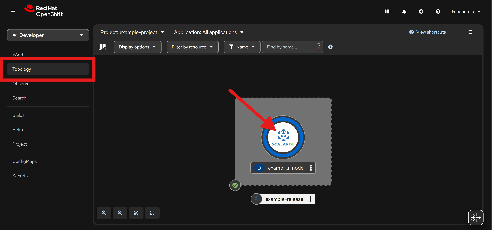
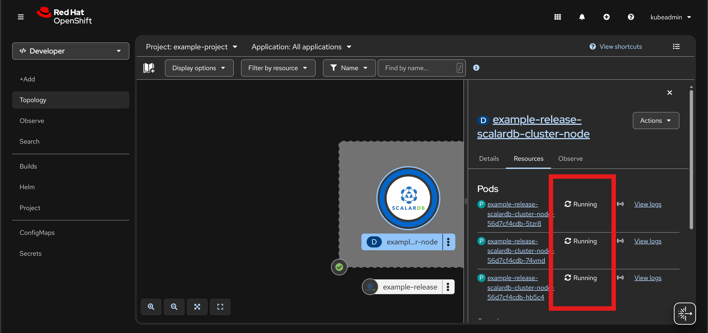
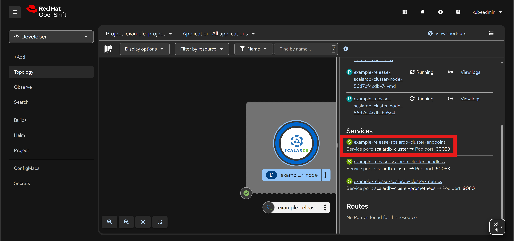
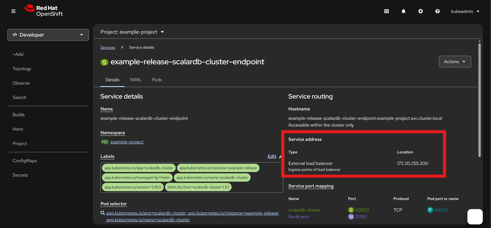
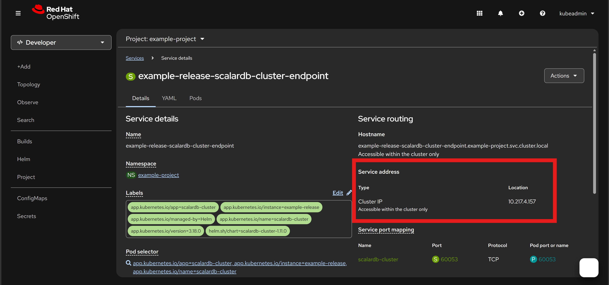

import Tabs from '@theme/Tabs';
import TabItem from '@theme/TabItem';

After deploying or upgrading ScalarDB Cluster, you should check the following points:

1. Check if the pod status is `Running` by doing the following:

    1. Select the **Topology** tab, then click the **ScalarDB icon** inside the circle of your release.

        

    1. You can see the status of each pod in the right pane.

        

1. Check if the service is exposed by doing the following:

    1. Select the **Topology** tab, then click the **ScalarDB icon** inside the circle of your release.

        

    1. Scroll down the right pane, then click the service with the suffix `-endpoint`.

        

        <Tabs groupId="connectivity" queryString>
            <TabItem value="external-k8s" label="Access from outside the OpenShift cluster" default>
                If you set `scalardbCluster.service.type` to `LoadBalancer` in **Create a custom values file**, you'll see **External load balancer** in the **Type** column and an actual IP address or a hostname in the **Location** column. Note that the actual value of the IP address or hostname depends on your environment.

                
            </TabItem>
            <TabItem value="internal-k8s" label="Access from inside the OpenShift cluster">
                If you set `scalardbCluster.service.type` to `ClusterIP` in **Create a custom values file**, you'll see **Cluster IP** in the **Type** column and an actual IP address in the **Location** column.

                
            </TabItem>
        </Tabs>
