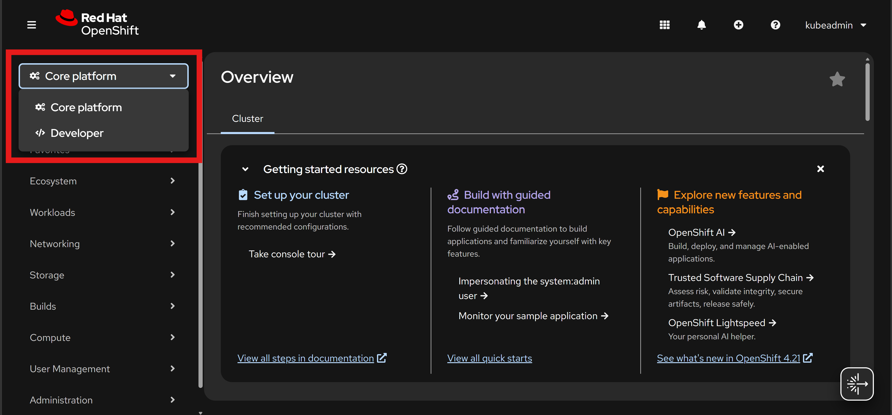
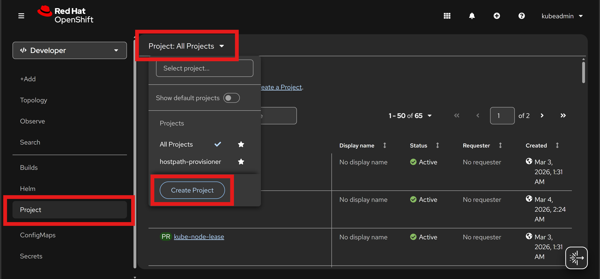
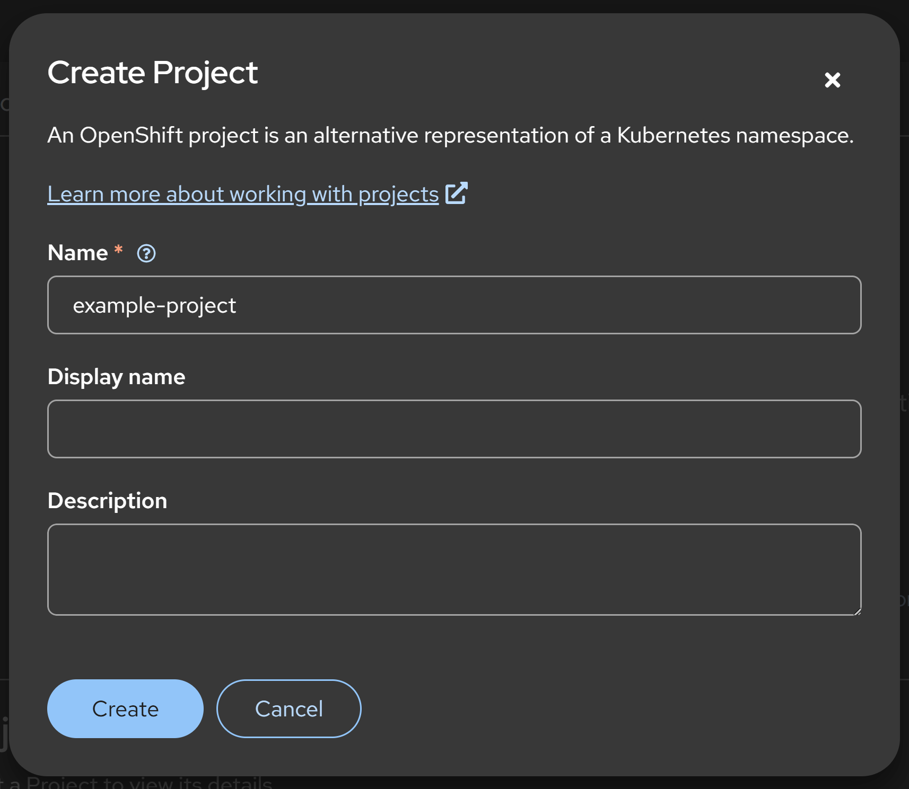

1. Click **Developer** in the dropdown at the top left.

    

1. Select the **Project** tab, click the **Project: All Projects** dropdown, then choose the **Create Project** button.

    

1. Enter project information for your environment and click the **Create** button.

    
