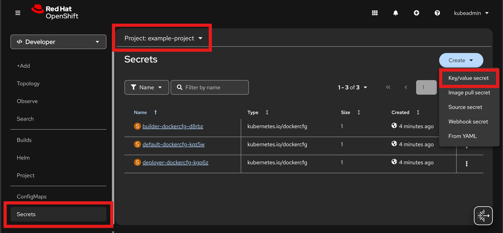
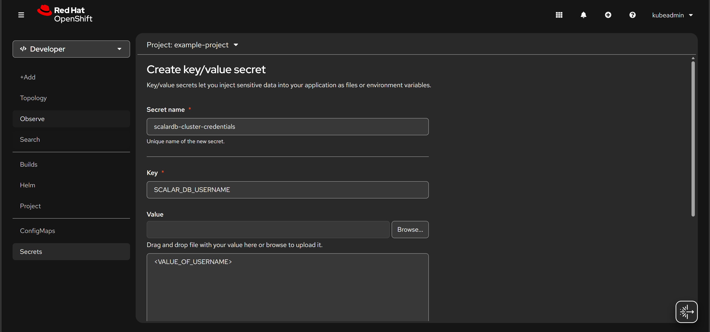
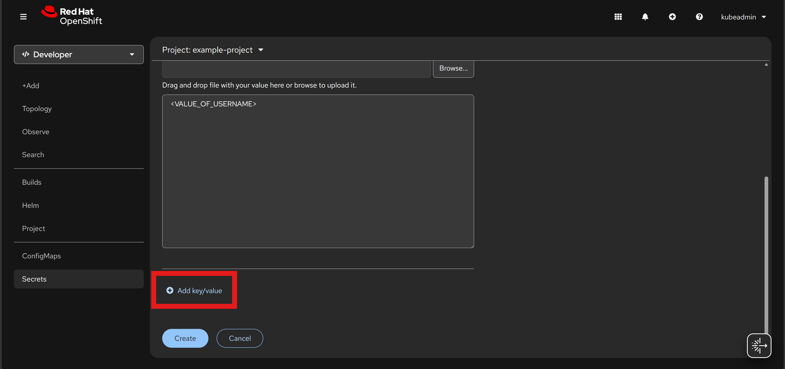
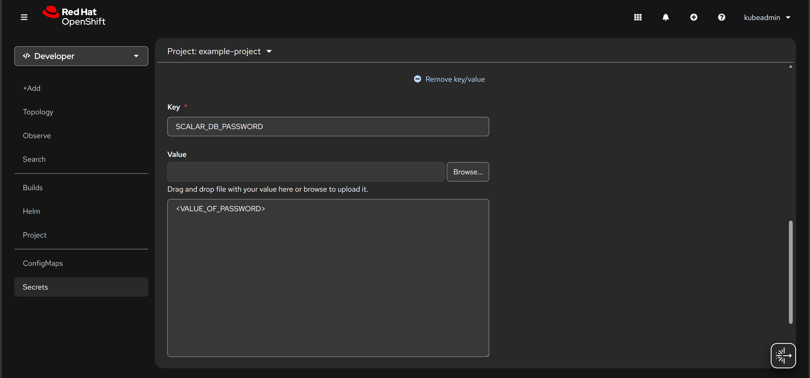
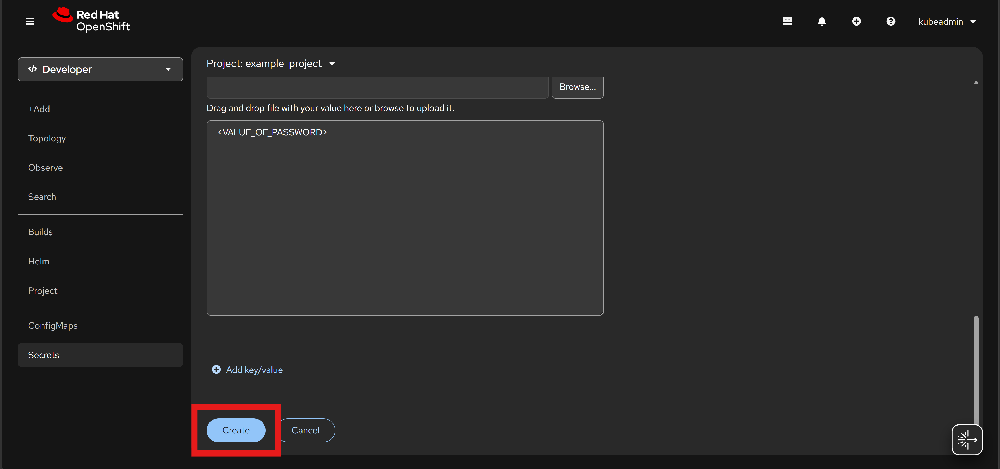

You should set the credentials to access the backend database through the secret resource.

:::warning

Although you can set the credentials directly in the configuration file without using a secret resource, doing so is not secure and therefore not recommended.

:::

1. Select the **Secrets** tab, confirm the current project is one you created in the previous step, click the **Create** dropdown, then choose **Key/value secret**.

    

1. Enter `scalardb-cluster-credentials` in the **Secret name** text box, enter `SCALAR_DB_USERNAME` in the **Key** text box, then enter an actual username in the **Value** text box.

    

1. Scroll down the page, then click the **Add key/value** button.

    

1. In a new added key/value, enter `SCALAR_DB_PASSWORD` in the **Key** text box, then enter an actual password in the **Value** text box.

    

1. Scroll down the page, then click the **Create** button.

    
