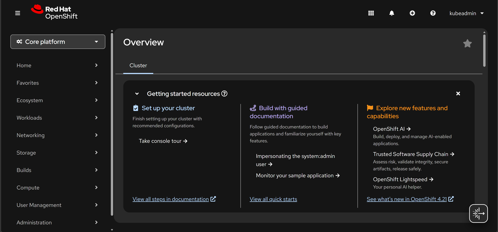

1. Deploy OpenShift by following the [official OpenShift documentation](https://docs.redhat.com/en/documentation/openshift_container_platform/4.21/html-single/installation_overview/index). You can also use an OpenShift managed service.

1. Check if the OpenShift cluster is running by logging in to the web console.

    
