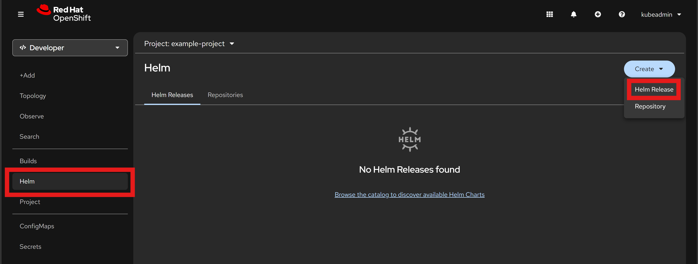
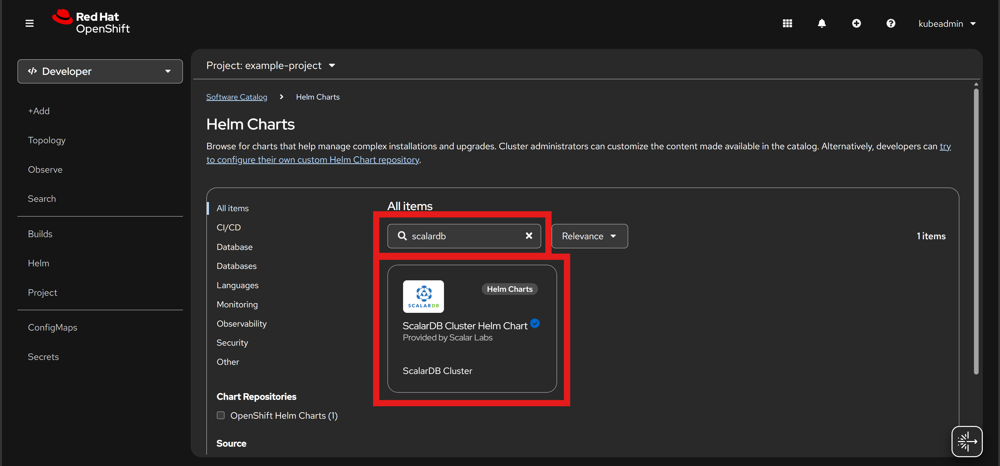
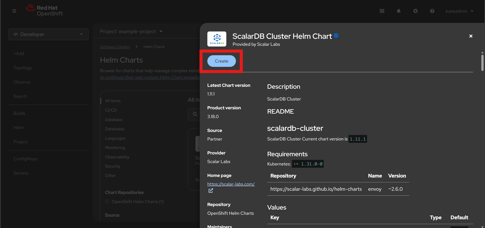
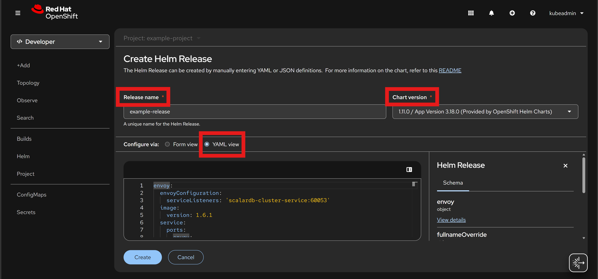
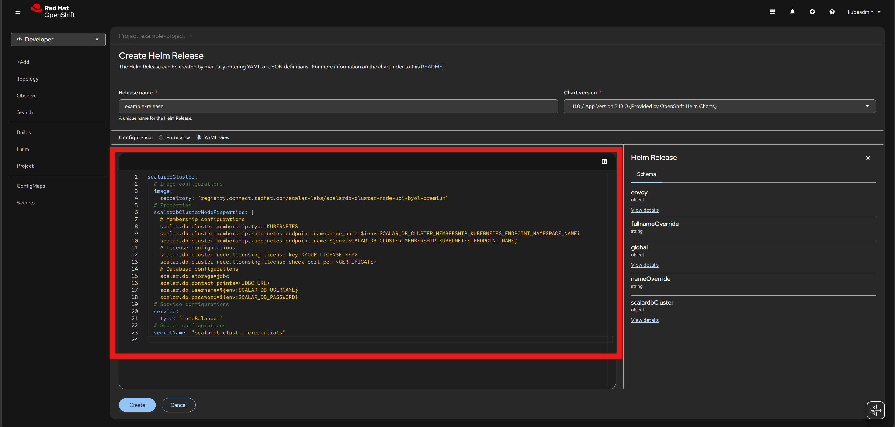
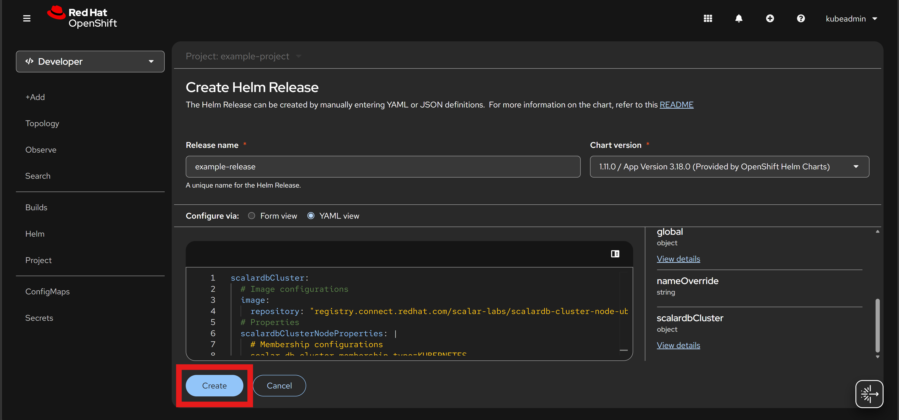
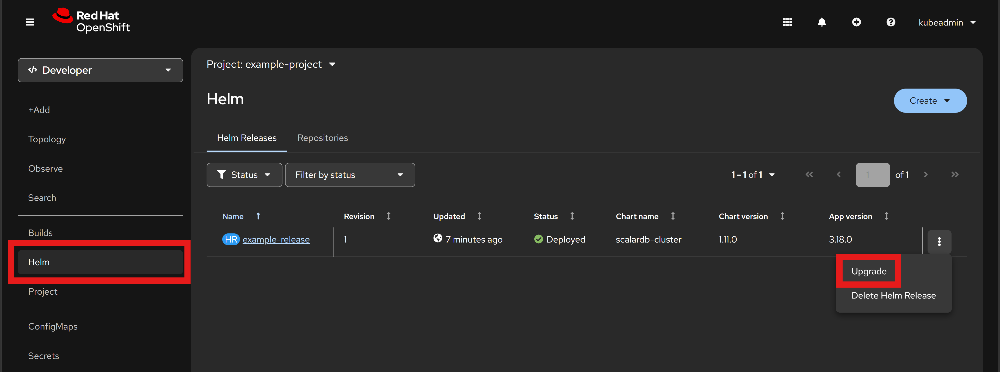
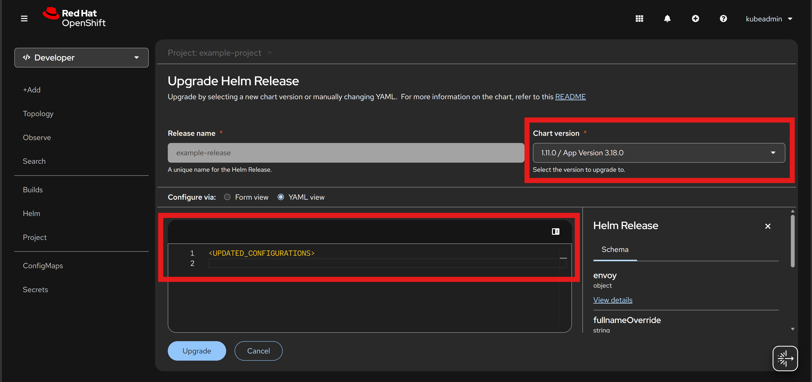
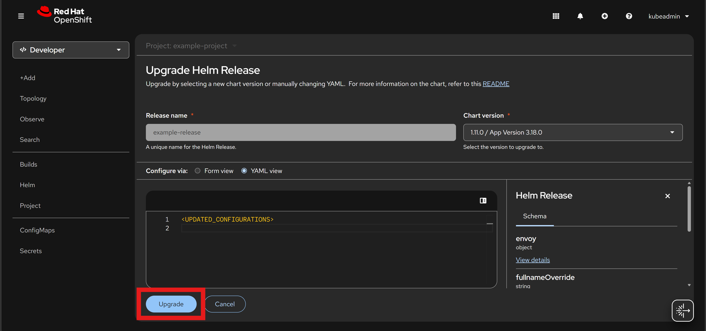
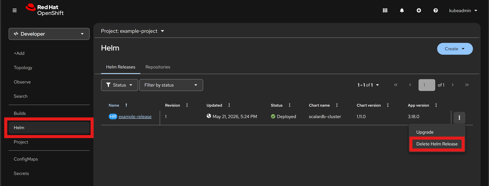

import Tabs from '@theme/Tabs';
import TabItem from '@theme/TabItem';
import CodeBlock from '@theme/CodeBlock';

Deploy, upgrade, or uninstall the ScalarDB Cluster deployment by using Helm in the web console with your custom values file `scalardb-cluster.yaml` that you created in **Create a custom values file**.

<Tabs groupId="operations" queryString>
  <TabItem value="deploy" label="Deploy" default>
    1. Select the **Helm** tab, click the **Create** dropdown, then choose **Helm Release**.

        

    1. Enter `scalardb` in the search box, then click **ScalarDB Cluster Helm Chart provided by Scalar Labs**.

        

    1. Click the **Create** button.

        

    1. Enter your Helm release name in the **Release name** text box, select the chart version you want to deploy in the **Chart version** dropdown, then select the **YAML view** radio button in the **Configure via** field.

        

    1. Enter the custom values you created in the previous step in the text box.

        

    1. Click the **Create** button.

        
  </TabItem>
  <TabItem value="upgrade" label="Upgrade">
    1. Select the **Helm** tab, click the **vertical ellipsis** button of the release, then choose **Upgrade**.

        

    1. Change the version of the chart in the **Chart version** dropdown if you want to upgrade the version, and change the configurations in the text box if you want to upgrade the configurations.

        

    1. Click the `Upgrade` button.

        
  </TabItem>
  <TabItem value="uninstall" label="Uninstall">
    1. Select the **Helm** tab, click the **vertical ellipsis** button of the release, then choose **Delete Helm Release**.

        
  </TabItem>
</Tabs>
