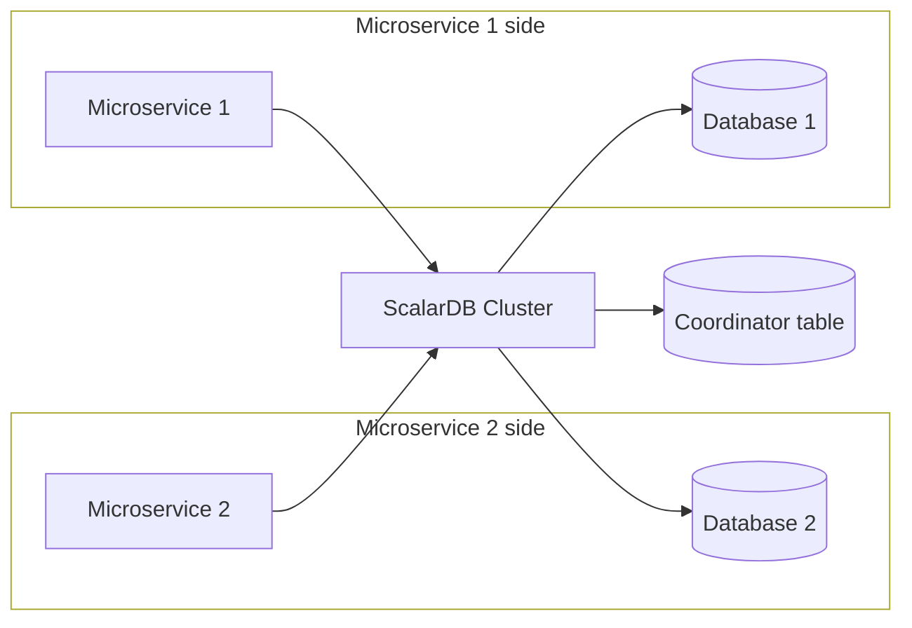
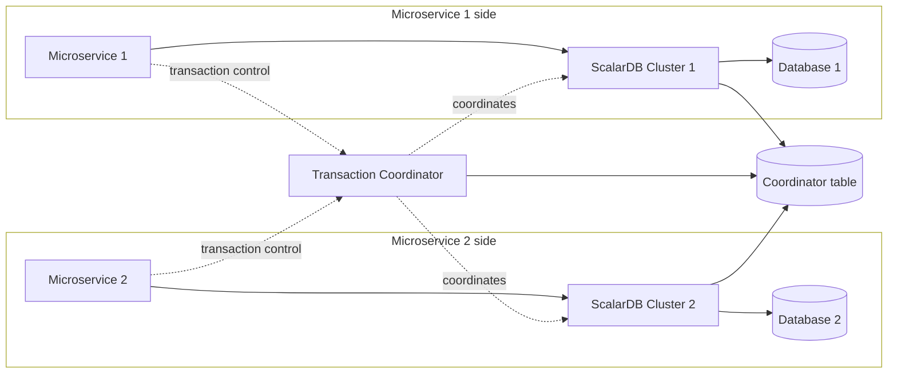

---
tags:
  - Enterprise Standard
  - Enterprise Premium
displayed_sidebar: docsJapanese
---

# マイクロサービスにおける ScalarDB Cluster のデプロイパターン

import TranslationBanner from '/src/components/_translation-ja-jp.mdx';

<TranslationBanner />

ScalarDB Cluster を使用するマイクロサービスアプリケーションを構築する場合、ScalarDB Cluster のデプロイ方法として、共有クラスターパターンと分離クラスターパターンの2つのパターンを選択できます。
このドキュメントでは、まずこれらのパターンについて説明し、それらの違いと、どの場合にどちらを選択するかの基本的なガイドラインを示します。

また、このドキュメントでは、マイクロサービスアプリケーションが database-per-service パターンに基づいて作成されているものと想定しています。このパターンでは、各マイクロサービスがデータベースを管理し、マイクロサービスはマイクロサービス間の API を介して別のマイクロサービスのデータベースにアクセスする必要があります。

## ScalarDB Cluster のデプロイパターン

共有クラスターパターンでは、マイクロサービスはシステム内で1つの ScalarDB Cluster インスタンス (ScalarDB Cluster ノードのクラスタ) を共有するため、同じ ScalarDB Cluster インスタンスにアクセスしてデータベースとやり取りします。一方、分離クラスターパターンでは、マイクロサービスは複数の ScalarDB Cluster インスタンスを使用します。通常、1つのマイクロサービスが1つの ScalarDB Cluster インスタンスにアクセスしてデータベースとやり取りし、Transaction Coordinator と呼ばれる別のコンポーネントがそれらのインスタンス間の各トランザクションを調整します。

次の図は共有クラスターパターンを示しています。マイクロサービスは同じ ScalarDB Cluster インスタンスを通じてすべてのデータベースにアクセスします。

次の図は分離クラスターパターンを示しています。各マイクロサービスはデータベースに加えて ScalarDB Cluster インスタンスを所有します。マイクロサービスの外側に残るのは共有されるコンポーネントです。トランザクションを調整する Transaction Coordinator と、Transaction Coordinator および両方の ScalarDB Cluster インスタンスが読み書きする Coordinator テーブルです。

:::note

どちらのパターンでも、マイクロサービスに必要なデータベースに加えて、Coordinator テーブルも管理する必要があります。分離クラスターパターンでは、Transaction Coordinator とすべての ScalarDB Cluster インスタンスが Coordinator テーブルを保持するデータベースに到達できる必要があります。

:::

## パターンがアプリケーションコードに与える影響

マイクロサービスをまたがるトランザクションを実行するには、どちらのパターンでも Microservice Transaction API を使用します。API の詳細については、[ScalarDB Cluster Java API ガイド](./api-guide.mdx#microservice-transaction-api)を参照してください。

アプリケーションコードはパターン間で変わりません。マイクロサービスはコミットプロトコルを相互に調整しません。共有クラスターパターンでは、単一の ScalarDB Cluster インスタンスがマイクロサービスに代わってそれを行い、分離クラスターパターンでは Transaction Coordinator がそれを行います。どちらの場合も、トランザクションを開始し、レコードを読み書きし、コミットするコードは両方のパターンで同じです。パターン間の違いは設定のみです。

そのため、パターンの選択はプログラミングモデルの決定ではなく、デプロイメントの決定です。マイクロサービスを書き直すことなく、後でパターンを変更することができます。このドキュメントの残りの部分では、その決定を行う際に考慮すべき点について説明します。

## 長所と短所

明らかな違いの1つは、ScalarDB Cluster インスタンスのリソースの量です。分離クラスターパターンでは、アプリケーションを管理するためのリソースが増えます。これにより、メンテナンスの負担とコストも増加します。

また、分離クラスターパターンでは追加のコンポーネントが必要です。Transaction Coordinator が ScalarDB Cluster インスタンス間の各トランザクションを調整するため、それらと並行してデプロイおよび運用する必要があります。未完了のトランザクションが残したレコードを見つけたインスタンスはそのトランザクションの状態を参照してレコードを回復するため、すべての ScalarDB Cluster インスタンスが Coordinator テーブルに到達できる必要があります。

さらに、リソースの分離レベルも異なります。マイクロサービスは、保守性と開発効率を高めるために十分に分離されている必要がありますが、共有クラスターパターンではリソースの分離が弱くなります。リソースの分離が弱いと、セキュリティも弱くなる可能性があります。ただし、認証や承認などの ScalarDB Cluster のセキュリティ機能を使用することで、セキュリティリスクを軽減できます。

同様に、システムの管理方法にも違いがあります。具体的には、共有クラスターパターンでは、他のチームに代わって ScalarDB Cluster インスタンスを管理するタスクをチームに割り当てる必要があります。通常は中央データチームが管理しますが、そのようなチームが存在しない場合は問題が発生する可能性があります。分離クラスターパターンでは、管理のバランスがより取れていますが、マイクロサービス間で共有される Transaction Coordinator と Coordinator テーブルに関して同様の問題が発生します。この問題は、1つのチームに Transaction Coordinator と Coordinator テーブルをまとめて管理させることで対処できます。

次に、パターンの長所と短所をまとめます。

### 共有クラスターパターン

- **長所:**
  - 複数の ScalarDB Cluster インスタンスも Transaction Coordinator も不要なため、デプロイと運用がシンプルです。(データベースのバックアップ操作も簡単です。)
  - 1つの ScalarDB Cluster インスタンスを使用するため、リソース使用量が少なくなります。
- **短所:**
  - マイクロサービス間のリソース分離が弱い。
  - 管理のバランスが取れていない。(1つのチームが他のチームに代わって ScalarDB Cluster インスタンスを管理する必要があります。)

### 分離クラスターパターン

- **利点:**
  - リソースの分離が向上します。
  - 管理のバランスがより取れます。(1つのチームが1つのマイクロサービスと1つの ScalarDB Cluster インスタンスを管理します。また、1つのチームに Transaction Coordinator と Coordinator テーブルの管理を任せる必要があります。)
- **欠点:**
  - 複数の ScalarDB Cluster インスタンスに加えて Transaction Coordinator も必要なため、デプロイおよび運用するコンポーネントが増えます。(データベースのバックアップ操作も複雑になることがあります。)
  - Coordinator テーブルを保持するデータベースが Transaction Coordinator とすべての ScalarDB Cluster インスタンスから到達可能である必要があります。
  - 複数の ScalarDB Cluster インスタンスがあるため、リソース使用量が増加します。

## どのパターンを選択するか

どちらのパターンもすべてのシステムに対して適切なデフォルトではないため、上記の長所と短所を要件と照らし合わせてパターンを選択してください。分離クラスターパターンを選択する場合は、チームが Transaction Coordinator を運用でき、Coordinator テーブルを保持するデータベースをすべての ScalarDB Cluster インスタンスから到達可能な状態に維持できることを確認してください。Transaction Coordinator とそのトランザクションに参加する ScalarDB Cluster インスタンスの設定方法の詳細については、[Transaction Coordinator の設定](./scalardb-cluster-configurations.mdx#transaction-coordinator-の設定)を参照してください。

ScalarDB Cluster インスタンスをマイクロサービス間で共有することが database-per-service パターンに違反するかどうか疑問に思うかもしれません。ScalarDB Cluster はすべての重要な状態を基盤となるデータベースに保存し、メモリには重要な状態を保持しないため、データベースへの単なるパスとして見ることができます。したがって、共有クラスターパターンのシステムは依然として database-per-service パターンに準拠しており、マイクロサービスの理念に概ね沿っています。

また、システム全体に1つのパターンを適用する代わりに、パターンを混在させることもできます。例えば、複数のマイクロサービスが1つの ScalarDB Cluster インスタンスを共有しながら、別のマイクロサービスが独自のインスタンスを持つことができます。このようなシステムでは、マイクロサービスが Transaction Coordinator を必要とするかどうかは、トランザクションの到達範囲によって異なります。単一の ScalarDB Cluster インスタンス内でのみトランザクションを実行するマイクロサービスは Transaction Coordinator を必要としませんが、ScalarDB Cluster インスタンスをまたがるトランザクションを実行するマイクロサービスは必要です。

どのパターンでもアプリケーションコードは同じなので、マイクロサービスを書き直すことなく後で選択を変更することもできます。

## 制限事項

ScalarDB は、CRUD、SQL、Spring Data JDBC などのいくつかの API を提供します。現在、Microservice Transaction API は CRUD インターフェースでのみサポートされています。SQL インターフェースと Spring Data JDBC インターフェースは、まだ Microservice Transaction API をサポートしていません。

## 参照

- [ScalarDB Cluster Java API ガイド](./api-guide.mdx)
- [Transaction Coordinator の設定](./scalardb-cluster-configurations.mdx#transaction-coordinator-の設定)
