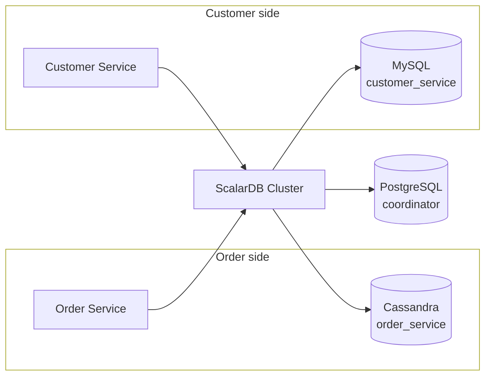
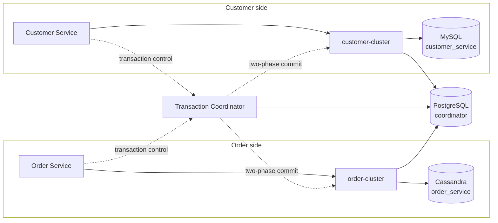
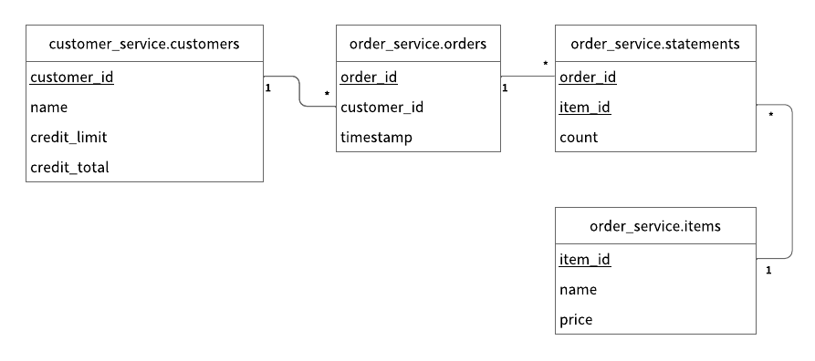

---
tags:
  - Enterprise Premium
displayed_sidebar: docsJapanese
---

# Microservice Transaction API を使用してマイクロサービストランザクションをサポートするアプリケーションを作成する

import TranslationBanner from '/src/components/_translation-ja-jp.mdx';
import Tabs from '@theme/Tabs';
import TabItem from '@theme/TabItem';
import WarningLicenseKeyContact from '../../components/_warning-license-key-contact.mdx';
import JDKVersions from '../../components/_prerequisites-jdk-versions.mdx';

<TranslationBanner />

このチュートリアルでは、Microservice Transaction API を使用して、マイクロサービストランザクションをサポートするサンプル電子商取引アプリケーションを作成する方法について説明します。

Microservice Transaction API を使用すると、2フェーズコミットプロトコルを自分で実装することなく、複数のプロセスにまたがる単一のトランザクションを実行できます。サービスが `prepare`、`validate`、または `commit` を呼び出すことはなく、ScalarDB Cluster がそれらを代行します。

そのため、同じアプリケーションコードをどちらの [ScalarDB Cluster デプロイパターン](../../scalardb-cluster/deployment-patterns-for-microservices.mdx)（共有クラスターパターンまたは分離クラスターパターン）でも実行できます。このサンプルはそれを具体的に示すために構成されています。アプリケーションコードのコピーが1つと、2セットの設定ファイルが含まれています。このページ全体でタブを使用してパターンを選択してください。選択内容はすべてのステップに引き継がれます。

:::note

両方のデプロイパターンで ScalarDB Cluster ノードが実行されるため、どちらを選択してもライセンスキーが必要です。

:::

## サンプルマイクロサービスアプリケーションの概要

サンプル電子商取引アプリケーションは、ユーザーが信用枠を使用してアイテムを注文・支払いする方法を示しています。

サンプルアプリケーションには、[database-per-service パターン](https://microservices.io/patterns/data/database-per-service.html)に基づく *Customer Service* と *Order Service* という2つのマイクロサービスがあります：

- **Customer Service** は、信用枠情報、信用限度額、信用合計など、顧客情報を管理します。
- **Order Service** は、注文処理の実行や注文履歴の取得など、注文操作を担当します。

各サービスには gRPC エンドポイントがあります。クライアントはエンドポイントを呼び出し、サービスも相互にエンドポイントを呼び出します。

サンプルアプリケーションで使用するデータベースは MySQL、Cassandra、および PostgreSQL です。Customer Service と Order Service は ScalarDB Cluster を通じてそれぞれ MySQL と Cassandra を使用し、PostgreSQL は Coordinator テーブルを保持します。両方のデプロイパターンで同じ3つのデータベースを使用し、各名前空間を同じデータベースに配置するため、パターン間で変わるのは ScalarDB のトポロジーのみです。

2つのデプロイパターンは、ScalarDB Cluster がサービスとデータベースの間にどのように配置されるかが異なります。

共有クラスターパターンでは、両方のサービスが1つのクラスターノードに接続し、そのノードが3つのデータベースすべてにアクセスします：



分離クラスターパターンでは、各サービスがクラスターを所有し、Transaction Coordinator がトランザクションを駆動し、Coordinator テーブルはすべてのコンポーネントがアクセスできる独自のストアに移動します：



両サイドは対称的です：それぞれがサービス、クラスター、データベースを所有します。それらの外側にあるのは共有されたもの、つまりトランザクションを駆動する Transaction Coordinator と、Transaction Coordinator および両方のクラスターが読み書きする Coordinator テーブルです。

アプリケーションコードは両方で同じです。設定のみが異なります。

:::note

サンプルアプリケーションは Microservice Transaction API の使用方法を示すことに重点を置いているため、アプリケーション固有のエラー処理、認証処理、および同様の機能はサンプルアプリケーションに含まれていません。

認証と認可は、2つのデプロイパターンの違いを読みやすくするために無効にされています。このトポロジーを実際のシステムに適用する前に、サービスごとのユーザーと名前空間の権限を追加してください。詳細については、[ユーザーの認証と認可](../../scalardb-cluster/scalardb-auth-with-sql.mdx)を参照してください。

:::

### サービスエンドポイント

サービスで定義されているエンドポイントは次のとおりです：

- Customer Service
    - `getCustomerInfo`
    - `payment`
    - `repayment`

- Order Service
    - `placeOrder`
    - `getOrder`
    - `getOrders`

:::note

Customer Service には `prepare`、`validate`、`commit`、または `rollback` エンドポイントがありません。それらを必要としないことが Microservice Transaction API のポイントです。

:::

### このサンプルアプリケーションで実行できること

サンプルアプリケーションは次の種類のトランザクションをサポートしています：

- Customer Service の `getCustomerInfo` エンドポイントを通じて顧客情報を取得します。
- Order Service の `placeOrder` エンドポイントと Customer Service の `payment` エンドポイントを通じて、信用枠を使用して注文を行います。
    - 注文のコストが顧客の信用限度額を下回っているかどうかを確認します。
    - チェックが成功した場合は、注文履歴を記録し、顧客が支払った金額を更新します。
- Order Service の `getOrder` エンドポイントと Customer Service の `getCustomerInfo` エンドポイントを通じて、注文 ID で注文情報を取得します。
- Order Service の `getOrders` エンドポイントと Customer Service の `getCustomerInfo` エンドポイントを通じて、顧客 ID で注文情報を取得します。
- Customer Service の `repayment` エンドポイントを通じて支払いを行います。
    - 顧客が支払った金額を減らします。

`placeOrder`、`getOrder`、および `getOrders` はそれぞれ両方のサービスにまたがる1つのトランザクションとして実行されるため、MySQL と Cassandra にまたがります。`getCustomerInfo` と `repayment` は、直接呼び出されると Customer Service 内のみで実行されるため、代わりに通常の Transaction API を使用します。

## Microservice Transaction API の仕組み

このセクションでは API 自体について説明します。これは両方のデプロイパターンに適用されます。完全な API リファレンスについては、[ScalarDB Cluster Java API ガイド](../../scalardb-cluster/api-guide.mdx#microservice-transaction-api)を参照してください。

この API はサービスにまたがるトランザクションにのみ使用してください。1つのサービス内に留まるトランザクションはプロセス間で調整するものがないため、代わりに通常の Transaction API (`DistributedTransactionManager`) を使用します。両方のマネージャーは同じ `TransactionFactory` と同じ設定ファイルから取得されます：

```java
TransactionFactory factory = TransactionFactory.create("<CONFIGURATION_FILE_PATH>");
DistributedTransactionManager transactionManager = factory.getTransactionManager();
GlobalTransactionManager globalTransactionManager = factory.getGlobalTransactionManager();
```

サービスにまたがるトランザクションには2種類のハンドルがあります：

- `begin()` または `beginReadOnly()` から取得した `GlobalTransaction`。トランザクション全体の結果を駆動し、データを保持しません。
- `beginBranch(transactionId)` から取得したサービスごとの `BranchTransaction`。そのサービスの作業の CRUD ハンドルです。

### イニシエーター

1つのサービスがトランザクションを開始し、その ID を他のサービスと共有し、結果を決定します。このサンプルでは、Order Service がイニシエーターです：

```java
GlobalTransaction global = globalTransactionManager.begin();
BranchTransaction branch = null;
try {
  branch = globalTransactionManager.beginBranch(global.getId());
  // ... this service's own CRUD ...
  branch.end(BranchTransaction.Status.SUCCESS);
  branch = null;

  callCustomerService(global.getId());  // pass the transaction ID over gRPC

  global.commit();
} catch (UnknownTransactionStatusException e) {
  // ... end the branch with FAILURE; do not roll back ...
} catch (Exception e) {
  // ... end the branch with FAILURE, then roll back ...
}
```

:::note

順序に注目してください：このサービスは他のサービスを呼び出す*前に*自身の作業を終了してブランチを終了します。リモート呼び出しをまたいでブランチを開いたままにすることも正しいですが、サービスが完了したらすぐにブランチを終了することが API が想定するイディオムです。

:::

### 参加者

トランザクション ID を受け取ったサービスは、自身のブランチで同じトランザクションに参加し、作業を行い、ブランチを終了します。コミットやロールバックは**行いません**—それはイニシエーターの責任です：

```java
BranchTransaction branch = globalTransactionManager.beginBranch(transactionId);
// ... this service's own CRUD ...
branch.end(BranchTransaction.Status.SUCCESS);
```

このサンプルでは、Customer Service はリクエストにトランザクション ID が含まれている場合に参加者として実行されます。それ以外の場合は作業がサービス内に留まるため、Microservice Transaction API ではなく Transaction API を通じて通常のトランザクションとして実行されます。`payment` エンドポイントは常に参加者です。`repayment` は決して参加者になりません。`getCustomerInfo` は呼び出し元によって、どちらにもなります。

### ブランチの終了は必須

すべてのブランチは、結果にかかわらず、正確に1回終了する必要があります。その義務はブランチを実行するプロセスに属し、他のどのプロセスもそれを代行することはできません。失敗パスでは、ブランチを `Status.FAILURE` で終了してください：

```java
branch.end(BranchTransaction.Status.FAILURE);
```

`end(FAILURE)` は寛容であり、`catch` ブロックから呼び出すことができます：すでに終了したブランチを終了することは何もしません（no-op）。元の失敗を隠すこともありません。

:::note

`end(Status)`、`commit()`、および `rollback()` はそれぞれチェック例外を宣言するため、それらを呼び出す `catch` ブロックは独自の処理が必要です。

:::

### エラー処理

イニシエーターのみがトランザクションを再開始できるため、イニシエーターのみが再試行します。このサンプルでは、Order Service が再試行ループを持ち、Customer Service も自身で実行するトランザクションに対して再試行ループを持ちます。参加者パスは再試行しません。

すべての失敗が再試行に値するわけではありません。サンプルは gRPC の `NOT_FOUND` および `FAILED_PRECONDITION` ステータスを決定論的なビジネス失敗（不明なアイテム、または超過した信用限度額）として扱い、それらを再試行しません。

`UnknownTransactionStatusException` は個別に処理され、再試行されません。トランザクションがコミットされたかどうかが不明であることを意味します。再試行するとコミット済みトランザクションが重複する可能性があります。実際のステータスを特定することはアプリケーションの責任です。

## 前提条件

- 以下のいずれかの Java Development Kit (JDK):
  <JDKVersions versionNumbers="8、11、17、または 21" />
- [Docker](https://www.docker.com/get-started/) 20.10以降 ([Docker Compose](https://docs.docker.com/compose/install/) V2以降)

<WarningLicenseKeyContact product="ScalarDB Cluster" />

## ScalarDB Cluster のセットアップ

次のセクションでは、ScalarDB Cluster で Microservice Transaction API を使用してマイクロサービストランザクションをサポートするサンプルアプリケーションをセットアップする方法について説明します。

### ScalarDB サンプルリポジトリをクローンする

**ターミナル**を開き、次のコマンドを実行して ScalarDB サンプルリポジトリをクローンします：

```console
git clone https://github.com/scalar-labs/scalardb-samples
```

次のコマンドを実行して、サンプルアプリケーションが含まれているディレクトリに移動します：

```console
cd scalardb-samples/microservice-transaction-sample-with-cluster/
```

### デプロイパターンの選択

サンプルにはアプリケーションコードのコピーが1つと、2つの設定ディレクトリが含まれています：

- **`shared-cluster/`:** 両方のサービスが1つの ScalarDB Cluster ノードに接続し、そのノードが両方の名前空間と Coordinator テーブルを保持します。
- **`separated-clusters/`:** 各サービスが ScalarDB Cluster ノードを所有し、Transaction Coordinator がそれらにまたがる2フェーズコミットを駆動します。Coordinator テーブルはパターン内のすべての ScalarDB コンポーネントがアクセスできる独自のストアに配置されます。

パターンの選択に関するガイダンスについては、[マイクロサービスにおける ScalarDB Cluster のデプロイパターン](../../scalardb-cluster/deployment-patterns-for-microservices.mdx)を参照してください。

以下でパターンを選択してください。選択内容はこのページのすべてのステップに適用されます。

<Tabs groupId="deployment_pattern" queryString>
  <TabItem value="shared_cluster" label="Shared cluster" default>
    このチュートリアルのすべてのコマンドは `shared-cluster` ディレクトリから実行します：

    ```console
    cd shared-cluster/
    ```
  </TabItem>
  <TabItem value="separated_clusters" label="Separated clusters">
    このチュートリアルのすべてのコマンドは `separated-clusters` ディレクトリから実行します：

    ```console
    cd separated-clusters/
    ```
  </TabItem>
</Tabs>

### ライセンスキーの設定

各 ScalarDB Cluster ノードは起動時にライセンスキーを確認するため、選択したパターンで実行されるすべてのノードのプロパティファイルに設定する必要があります。

<Tabs groupId="deployment_pattern" queryString>
  <TabItem value="shared_cluster" label="Shared cluster" default>
    `scalardb-cluster-node.properties` に ScalarDB Cluster のライセンスキーと証明書を設定します：

    ```properties
    scalar.db.cluster.node.licensing.license_key=<YOUR_LICENSE_KEY>
    scalar.db.cluster.node.licensing.license_check_cert_pem=<YOUR_LICENSE_CHECK_CERT_PEM>
    ```
  </TabItem>
  <TabItem value="separated_clusters" label="Separated clusters">
    `customer-cluster.properties` と `order-cluster.properties` の**両方**に ScalarDB Cluster のライセンスキーと証明書を設定します：

    ```properties
    scalar.db.cluster.node.licensing.license_key=<YOUR_LICENSE_KEY>
    scalar.db.cluster.node.licensing.license_check_cert_pem=<YOUR_LICENSE_CHECK_CERT_PEM>
    ```

    Transaction Coordinator はライセンスされたコンポーネントではなく、ライセンスキーは必要ありません。
  </TabItem>
</Tabs>

詳細については、[製品ライセンスキーの設定方法](../../scalar-licensing/index.mdx)を参照してください。

:::note

このサンプルアプリケーションを素早くセットアップするために、ScalarDB Cluster はスタンドアロンモードで実行され、ワイヤ暗号化は有効になっていません。本番環境では、ワイヤ暗号化を有効にすることをお勧めします。詳細については、[ScalarDB Cluster スタンドアロンモード](../../scalardb-cluster/standalone-mode.mdx)と[ワイヤ通信の暗号化](../../scalardb-cluster/encrypt-wire-communications.mdx)を参照してください。

:::

### ScalarDB Cluster の設定

両方のパターンのプロパティファイルはサンプルアプリケーション用にすでに設定されているため、このセクションと次のセクションでは、上記で設定したライセンスキー以外に変更する必要はありません。両セクションでは設定の内容を説明します。

クラスター側の設定は、2つのパターンが構造的に異なる部分です。続くマイクロサービスの設定は、主にここでの設定を反映しています。

<Tabs groupId="deployment_pattern" queryString>
  <TabItem value="shared_cluster" label="Shared cluster" default>
    1つのノードが両方のサービスにサービスを提供するため、両方の名前空間と Coordinator テーブルにアクセスする必要があります。`scalardb-cluster-node.properties` で MySQL、Cassandra、PostgreSQL にアクセスするためにマルチストレージを使用します：

    ```properties
    scalar.db.storage=multi-storage
    scalar.db.multi_storage.storages=mysql,cassandra,coordinatordb

    scalar.db.multi_storage.storages.mysql.storage=jdbc
    scalar.db.multi_storage.storages.mysql.contact_points=jdbc:mysql://mysql:3306/?sslMode=REQUIRED
    scalar.db.multi_storage.storages.mysql.username=root
    scalar.db.multi_storage.storages.mysql.password=mysql

    scalar.db.multi_storage.storages.cassandra.storage=cassandra
    scalar.db.multi_storage.storages.cassandra.contact_points=cassandra
    scalar.db.multi_storage.storages.cassandra.username=cassandra
    scalar.db.multi_storage.storages.cassandra.password=cassandra

    scalar.db.multi_storage.storages.coordinatordb.storage=jdbc
    scalar.db.multi_storage.storages.coordinatordb.contact_points=jdbc:postgresql://postgres:5432/postgres
    scalar.db.multi_storage.storages.coordinatordb.username=postgres
    scalar.db.multi_storage.storages.coordinatordb.password=postgres

    scalar.db.multi_storage.namespace_mapping=customer_service:mysql,coordinator:coordinatordb
    scalar.db.multi_storage.default_storage=cassandra

    scalar.db.cluster.node.standalone_mode.enabled=true
    ```

    `namespace_mapping` は各名前空間をストレージに送信し、`default_storage` はリストにない名前空間をキャッチします。これが `order_service` にエントリが必要ない理由です。Coordinator テーブルはここでも、もう一方のパターンでも独自のデータベースを取得し、各名前空間が両方のパターンで同じデータベースに配置され、トポロジーのみが異なります。

    `standalone_mode.enabled=true` はノードを静的メンバーシップを持つ単一インスタンスとして実行します。このキーがない場合、ノードは Kubernetes を通じてピアを検出しようとします。

    マルチストレージの詳細については、[マルチストレージトランザクションをサポートするように ScalarDB を設定する方法](../../multi-storage-transactions.mdx#マルチストレージトランザクションをサポートするように-scalardb-を設定する方法)を参照してください。スタンドアロンモードの詳細については、[ScalarDB Cluster スタンドアロンモード](../../scalardb-cluster/standalone-mode.mdx)を参照してください。
  </TabItem>
  <TabItem value="separated_clusters" label="Separated clusters">
    このパターンには、設定する2種類のノードがあります：参加者クラスターと Transaction Coordinator です。

    <h4>参加者クラスター</h4>

    各参加者クラスターは1つのアプリケーション名前空間を所有しますが、Coordinator テーブルにもアクセスする必要があるため、マルチストレージも使用します。2つのファイルは同じ形状を持ち、所有するデータベースと持つ ID が異なります。

    `customer-cluster.properties`:

    ```properties
    scalar.db.storage=multi-storage
    scalar.db.multi_storage.storages=mysql,coordinatordb

    scalar.db.multi_storage.storages.mysql.storage=jdbc
    scalar.db.multi_storage.storages.mysql.contact_points=jdbc:mysql://mysql:3306/?sslMode=REQUIRED
    scalar.db.multi_storage.storages.mysql.username=root
    scalar.db.multi_storage.storages.mysql.password=mysql

    scalar.db.multi_storage.storages.coordinatordb.storage=jdbc
    scalar.db.multi_storage.storages.coordinatordb.contact_points=jdbc:postgresql://postgres:5432/postgres
    scalar.db.multi_storage.storages.coordinatordb.username=postgres
    scalar.db.multi_storage.storages.coordinatordb.password=postgres
    scalar.db.multi_storage.storages.coordinatordb.jdbc.connection_pool.max_total=25
    scalar.db.multi_storage.storages.coordinatordb.jdbc.table_metadata.connection_pool.max_total=5

    scalar.db.multi_storage.namespace_mapping=coordinator:coordinatordb
    scalar.db.multi_storage.default_storage=mysql

    scalar.db.cluster.node.standalone_mode.enabled=true
    scalar.db.cluster.node.transaction_participant.enabled=true
    scalar.db.cluster.id=customer-cluster
    ```

    `order-cluster.properties`:

    ```properties
    scalar.db.storage=multi-storage
    scalar.db.multi_storage.storages=cassandra,coordinatordb

    scalar.db.multi_storage.storages.cassandra.storage=cassandra
    scalar.db.multi_storage.storages.cassandra.contact_points=cassandra
    scalar.db.multi_storage.storages.cassandra.username=cassandra
    scalar.db.multi_storage.storages.cassandra.password=cassandra

    scalar.db.multi_storage.storages.coordinatordb.storage=jdbc
    scalar.db.multi_storage.storages.coordinatordb.contact_points=jdbc:postgresql://postgres:5432/postgres
    scalar.db.multi_storage.storages.coordinatordb.username=postgres
    scalar.db.multi_storage.storages.coordinatordb.password=postgres
    scalar.db.multi_storage.storages.coordinatordb.jdbc.connection_pool.max_total=25
    scalar.db.multi_storage.storages.coordinatordb.jdbc.table_metadata.connection_pool.max_total=5

    scalar.db.multi_storage.namespace_mapping=coordinator:coordinatordb
    scalar.db.multi_storage.default_storage=cassandra

    scalar.db.cluster.node.standalone_mode.enabled=true
    scalar.db.cluster.node.transaction_participant.enabled=true
    scalar.db.cluster.id=order-cluster
    ```

  :::note

  両方のファイルは `coordinator` のみをマップし、`default_storage` を各自のデータベースに向けているため、同じ2行が各ファイルで異なる意味を持ちます。

  :::

    - **`namespace_mapping` および `default_storage`:** `coordinator` のみが明示的なマッピングを必要とします。アプリケーション名前空間は `default_storage` にフォールスルーし、それがこのクラスター自身のデータベースです。
    - **`...coordinatordb.jdbc.connection_pool.max_total`:** このパターンでは3つの ScalarDB コンポーネントが Coordinator データベースに接続しますが、デフォルトのプールサイズは1つを想定しています。デフォルトのままにすると、プールがデフォルトの PostgreSQL `max_connections` を使い果たし、ノードが `FATAL: sorry, too many clients already` で起動に失敗します。
    - **`scalar.db.cluster.node.transaction_participant.enabled`:** `TransactionParticipant` サービスを提供し、クラスターがすでに処理している通常のトランザクションに加えて、Transaction Coordinator がこのクラスターに対して2フェーズコミットを駆動できるようにします。この設定によって、クラスターが参加者になります。
    - **`scalar.db.cluster.id`:** 参加者 ID。参加者サービスが有効な場合に必要であり、対応するサービスのプロパティと Transaction Coordinator のクラスターリスト内の値と一致する必要があります。

    <h4>Transaction Coordinator</h4>

    Transaction Coordinator は、`transaction-coordinator.properties` でどのクラスターを調整するか、および Coordinator テーブルをどこに保持するかを知る必要があります：

    ```properties
    scalar.db.cluster.transaction_coordinator.standalone_mode.enabled=true

    scalar.db.cluster.transaction_coordinator.clusters=customer-cluster,order-cluster
    scalar.db.cluster.transaction_coordinator.clusters.customer-cluster.contact_points=indirect:customer-cluster
    scalar.db.cluster.transaction_coordinator.clusters.customer-cluster.contact_port=60053
    scalar.db.cluster.transaction_coordinator.clusters.order-cluster.contact_points=indirect:order-cluster
    scalar.db.cluster.transaction_coordinator.clusters.order-cluster.contact_port=60053

    scalar.db.storage=jdbc
    scalar.db.contact_points=jdbc:postgresql://postgres:5432/postgres
    scalar.db.username=postgres
    scalar.db.password=postgres
    scalar.db.jdbc.connection_pool.max_total=25
    scalar.db.jdbc.table_metadata.connection_pool.max_total=5
    ```

    - **`scalar.db.cluster.transaction_coordinator.clusters`:** このコーディネーターが駆動する参加者クラスター。`scalar.db.cluster.id` で設定した ID で名前付けされています。各クラスターは独自の `contact_points` が必要で、デフォルトの `60053` でない場合は `contact_port` も必要です。
    - **`scalar.db.storage` および `scalar.db.contact_points`:** Coordinator テーブルを保持するストレージ。コーディネーター固有のキーではなく、標準のストレージ設定で設定されます。Transaction Coordinator は起動時にこの接続を開き、失敗すると終了します。

    このサンプルは必要なものだけを設定します。ポート、メンバーシップ、ワイヤ暗号化を含む Transaction Coordinator 設定の完全なセットについては、[Transaction Coordinator の設定](../../scalardb-cluster/scalardb-cluster-configurations.mdx#transaction-coordinator-の設定)を参照してください。

  :::note

  Transaction Coordinator の設定は `scalar.db.cluster.transaction_coordinator.` の下にあり、これはクラスターノードの `scalar.db.cluster.node.` とは異なるプレフィックスです。特に、`standalone_mode.enabled` は両方のプレフィックスの下に存在し、それらは交換可能ではありません。Transaction Coordinator イメージはメンバーシップタイプを Kubernetes にデフォルト設定しているため、独自の `standalone_mode` キーを認識しないコーディネーターは、起動する代わりに Kubernetes API に接続しようとします。

  :::

    Transaction Coordinator はライセンスされたコンポーネントではなく、ライセンスキーは必要ありません。
  </TabItem>
</Tabs>

### マイクロサービスの設定

ここが2つのパターンが実際に異なる部分です。アプリケーションコードは同一です。これらのプロパティのみが変わります。

<Tabs groupId="deployment_pattern" queryString>
  <TabItem value="shared_cluster" label="Shared cluster" default>
    両方のサービスが同じクラスターノードに接続し、そのノードがトランザクションを保持します。Transaction Coordinator は関与しないため、`customer-service.properties` と `order-service.properties` は同一です：

    ```properties
    scalar.db.transaction_manager=cluster
    scalar.db.contact_points=indirect:scalardb-cluster-node
    scalar.db.cluster.client.transaction_coordinator.enabled=false
    ```

    `transaction_coordinator.enabled=false` はデフォルトであり、省略することもできます。もう一方のパターンとの違いがファイル内で明示的に見えるように記述されています。
  </TabItem>
  <TabItem value="separated_clusters" label="Separated clusters">
    各サービスは所有するクラスターに接続し、両方が同じ Transaction Coordinator にトランザクション制御を送信します。そのため、2つのファイルは2か所 (接続先のクラスターと、自身を識別する ID) で異なりますが、それ以外はすべて一致しています。

    `customer-service.properties`:

    ```properties
    scalar.db.transaction_manager=cluster
    scalar.db.contact_points=indirect:customer-cluster
    scalar.db.cluster.id=customer-cluster
    scalar.db.cluster.client.transaction_coordinator.enabled=true
    scalar.db.cluster.client.transaction_coordinator.contact_points=indirect:transaction-coordinator
    scalar.db.cluster.client.transaction_coordinator.contact_port=60055
    ```

    `order-service.properties`:

    ```properties
    scalar.db.transaction_manager=cluster
    scalar.db.contact_points=indirect:order-cluster
    scalar.db.cluster.id=order-cluster
    scalar.db.cluster.client.transaction_coordinator.enabled=true
    scalar.db.cluster.client.transaction_coordinator.contact_points=indirect:transaction-coordinator
    scalar.db.cluster.client.transaction_coordinator.contact_port=60055
    ```

    このパターンが追加する設定は次のとおりです。

    - **`scalar.db.cluster.id`:** このサービスが属するクラスターの識別子。Transaction Coordinator はこれを使用して、ブランチがどの参加者に属するかを識別します。値は対応するクラスターノードに設定された値と一致し、Transaction Coordinator の `scalar.db.cluster.transaction_coordinator.clusters` に表示される必要があります。これら3つの場所が同じ参加者を指定します。
    - **`scalar.db.cluster.client.transaction_coordinator.enabled`:** `getGlobalTransactionManager()` が返すバッキングを指定します。`false` の場合、トランザクションはサービスが接続している単一クラスター内に存在します。`true` の場合、トランザクション制御は Transaction Coordinator にルーティングされ、参加者クラスター全体で2フェーズコミットを駆動します。この1つの設定がデプロイパターンを選択します。`getTransactionManager()` には影響なく、常にサービスが接続しているクラスターに直接接続するため、1つのサービス内に留まるトランザクションは両方のパターンで同じように実行されます。
    - **`scalar.db.cluster.client.transaction_coordinator.contact_points`:** トランザクション制御を送信する Transaction Coordinator。`scalar.db.contact_points` と同じ形式を使用します：単一エンドポイントを通じてアクセスするには `indirect:<HOST>`、Kubernetes エンドポイント API を通じてノードを検出するには `direct-kubernetes:<NAMESPACE>/<ENDPOINT>`。
    - **`scalar.db.cluster.client.transaction_coordinator.contact_port`:** Transaction Coordinator のポート。デフォルトは `60055` で、クラスターノードの `60053` とは異なります。

  :::note

  `scalar.db.cluster.id` は、Transaction Coordinator が有効になっており、サービスがクラスターにも接続している場合（ここの両方のサービスの場合）、クラスターノードだけでなくクライアントにも必要です。これがないと、サービスは起動時に [`DB-CLUSTER-10080`](../../scalardb-cluster/scalardb-cluster-status-codes.mdx#db-cluster-10080) で失敗します。

  :::
  </TabItem>
</Tabs>

### データベースと ScalarDB Cluster の起動

各サービスは起動時に ScalarDB Cluster に接続するため、マイクロサービスの前にインフラストラクチャを起動します。コンテナの数はパターンによって異なります。

<Tabs groupId="deployment_pattern" queryString>
  <TabItem value="shared_cluster" label="Shared cluster" default>
    MySQL、Cassandra、PostgreSQL、および1つの ScalarDB Cluster ノードを起動します：

    ```console
    docker compose up -d mysql cassandra postgres scalardb-cluster-node
    ```

    クラスターノードはマルチストレージ設定を使用します：MySQL は `customer_service` 名前空間を保持し、Cassandra は `order_service` を保持し、PostgreSQL は Coordinator テーブルを保持します。詳細については、[マルチストレージトランザクションをサポートするように ScalarDB を設定する方法](../../multi-storage-transactions.mdx#マルチストレージトランザクションをサポートするように-scalardb-を設定する方法)を参照してください。
  </TabItem>
  <TabItem value="separated_clusters" label="Separated clusters">
    MySQL、Cassandra、PostgreSQL、両方のクラスターノード、および Transaction Coordinator を起動します：

    ```console
    docker compose up -d mysql cassandra postgres customer-cluster order-cluster transaction-coordinator
    ```

    PostgreSQL は Coordinator テーブルを保持します。Transaction Coordinator は起動時にその接続を開き、失敗すると終了するため、PostgreSQL が健全になるまで起動を待ちます。

    Transaction Coordinator だけでなく、両方のクラスターノードも PostgreSQL に接続します。読み取りで未完了のトランザクションによって残されたレコードが見つかった場合、クラスターは Coordinator テーブルでそのトランザクションの状態を調べ、ロールフォワードまたはロールバックするかを決定します。それらのテーブルに到達できない参加者はそのようなレコードを回復できません。これが、このパターンの各クラスターノードがマルチストレージを使用する理由です：自身の名前空間のための独自のデータベース、および `coordinator` 名前空間のための PostgreSQL。
  </TabItem>
</Tabs>

:::note

開発環境によっては、Docker コンテナの起動に1分以上かかる場合があります。

:::

### スキーマのロード

スキーマは選択したディレクトリの JSON ファイルに定義されています。スキーマを適用するには、ScalarDB の[リリース](https://github.com/scalar-labs/scalardb/releases)ページに移動し、使用する ScalarDB Cluster のバージョンに対応する ScalarDB Cluster Schema Loader (`scalardb-cluster-schema-loader-<X.Y.Z>-all.jar`) をダウンロードします。

次のコマンドを実行します。`<X.Y.Z>` はダウンロードしたバージョンに置き換えてください。

<Tabs groupId="deployment_pattern" queryString>
  <TabItem value="shared_cluster" label="Shared cluster" default>
    1つのクラスターがすべてを保持するため、1回の実行で両方のサービスのテーブルと Coordinator テーブルが適用されます：

    ```console
    java -jar scalardb-cluster-schema-loader-<X.Y.Z>-all.jar \
      --config scalardb-cluster-node-client.properties \
      --schema-file schema.json --coordinator
    ```

    `--coordinator` オプションは必須です。Coordinator テーブルは JSON スキーマファイルで宣言できません。
  </TabItem>
  <TabItem value="separated_clusters" label="Separated clusters">
    各クラスターは独自の名前空間を所有し、Transaction Coordinator は別のデータベースに Coordinator テーブルを所有するため、スキーマは3か所に適用されます：

    ```console
    java -jar scalardb-cluster-schema-loader-<X.Y.Z>-all.jar \
      --config customer-cluster-client.properties \
      --schema-file schema-for-customer-service.json

    java -jar scalardb-cluster-schema-loader-<X.Y.Z>-all.jar \
      --config order-cluster-client.properties \
      --schema-file schema-for-order-service.json

    java -jar scalardb-cluster-schema-loader-<X.Y.Z>-all.jar \
      --config tc-coordinator-storage.properties --coordinator
    ```

    3番目のコマンドは、Transaction Coordinator がトランザクション制御を提供し、スキーマ管理は行わないため、クラスターを通じてではなく PostgreSQL に直接通信します。

  :::note

  スキーマのロードは2つのパターン間で本当に異なるものの1つです。設定のみが変わるという主張はアプリケーションコードについてであり、デプロイ全体についてではありません。

  :::
  </TabItem>
</Tabs>

#### スキーマの詳細

Customer Service のすべてのテーブルは `customer_service` 名前空間に作成されます：

- `customer_service.customers`: 顧客情報を管理するテーブル
  - `credit_limit`: 貸し手が各顧客に信用枠の使用を許可する最大金額
  - `credit_total`: 各顧客が信用枠を使用してすでに使用した金額

Order Service のすべてのテーブルは `order_service` 名前空間に作成されます：

- `order_service.orders`: 注文情報を管理するテーブル
- `order_service.statements`: 注文明細情報を管理するテーブル
- `order_service.items`: 注文するアイテムの情報を管理するテーブル

スキーマのエンティティリレーションシップダイアグラムは次のとおりです：



## マイクロサービスの起動

2つのサービスの Docker イメージをビルドして起動します。Gradle ビルドはサンプルのルートに定義されているため、`-p ..` はパターンのディレクトリにいる間に Gradle をそこに向けます：

```console
../gradlew -p .. :customer-service:docker :order-service:docker
docker compose up -d customer-service order-service
```

イメージには設定が含まれていません。各パターンの `docker-compose.yml` が必要なプロパティファイルをマウントするため、同じイメージタグが両方のパターンに対して実行されます。イメージがパターン間で同じであることを確認できます：

```console
docker image inspect --format '{{.Id}}' sample-mstx-order-service:1.0
```

各サービスは起動時に独自の初期データをロードするため、別途のデータロードステップは不要です。Customer Service は3人の顧客をシードし、Order Service は注文できる5つのアイテムをシードします。

## サンプルアプリケーションでトランザクションを実行し、データを取得する

次のセクションでは、サンプル電子商取引アプリケーションでトランザクションを実行し、データを取得する方法について説明します。コマンドとその結果は両方のデプロイパターンで同じです。

次のコマンドを実行して、サンプルのルートディレクトリに戻ります：

```console
cd ..
```

### 顧客情報を取得する

次のコマンドを実行して、ID が `1` である顧客に関する情報を取得することから始めます：

```console
./gradlew :client:run --args="GetCustomerInfo 1" -q
```

次の出力が表示されます：

```console
{
  "id": 1,
  "name": "Yamada Taro",
  "creditLimit": 10000
}
```

この時点では `creditTotal` は表示されていません。これは `creditTotal` の現在の値が `0` であることを意味します。

### 注文する

次に、次のコマンドを実行して、顧客 ID `1` にリンゴ2個とオレンジ1個を注文してもらいます：

:::note

このコマンドの注文形式は `./gradlew :client:run --args="PlaceOrder <CUSTOMER_ID> <ITEM_ID>:<COUNT>,<ITEM_ID>:<COUNT>,..."` です。

:::

```console
./gradlew :client:run --args="PlaceOrder 1 1:2,2:1" -q
```

以下のように、`orderId` の UUID が異なる、注文が成功したことを示す出力が表示されます：

```console
{
  "orderId": "bcb15594-9a0a-449e-ba20-e1dfed9e6e1e"
}
```

この1つのコマンドは両方のサービスにまたがるトランザクションを実行しました：Order Service が注文とその明細を記録し、Customer Service が顧客の信用枠に課金しました。どちらも発生したか、どちらも発生しなかったかのどちらかです。

### 注文の詳細を確認する

次のコマンドを実行して注文の詳細を確認します。`<ORDER_ID_UUID>` は、前のコマンドを実行した後に表示される `orderId` の UUID に置き換えます：

```console
./gradlew :client:run --args="GetOrder <ORDER_ID_UUID>" -q
```

`orderId` の UUID と `timestamp` の値が異なる、以下のような出力が表示されます：

```console
{
  "order": {
    "orderId": "bcb15594-9a0a-449e-ba20-e1dfed9e6e1e",
    "timestamp": "1788401092031",
    "customerId": 1,
    "customerName": "Yamada Taro",
    "statement": [{
      "itemId": 1,
      "itemName": "Apple",
      "price": 1000,
      "count": 2,
      "total": 2000
    }, {
      "itemId": 2,
      "itemName": "Orange",
      "price": 2000,
      "count": 1,
      "total": 2000
    }],
    "total": 4000
  }
}
```

`customerName` は Customer Service からのものです。これは読み取り専用のトランザクション（Order Service が `beginReadOnly()` で開始）で、それでも両方のサービスにまたがっています。

### クレジット合計の確認

次のコマンドを実行して、顧客のクレジット合計を確認します：

```console
./gradlew :client:run --args="GetCustomerInfo 1" -q
```

次の出力が表示されます。これは、顧客 ID `1` がクレジットの `4000` を使用したことを示しています：

```console
{
  "id": 1,
  "name": "Yamada Taro",
  "creditLimit": 10000,
  "creditTotal": 4000
}
```

### トランザクションのロールバックを確認する

次に、顧客の残りのクレジットを超える注文を試みます。`10000` の限度額のうち既に `4000` を使用している状態で、単価 `3000` のメロンを3個注文すると、代金は `9000` になります：

```console
./gradlew :client:run --args="PlaceOrder 1 5:3" -q
```

コマンドは `FAILED_PRECONDITION: Credit limit exceeded` で失敗します。その後、両方のサービスを確認します：

```console
./gradlew :client:run --args="GetCustomerInfo 1" -q
./gradlew :client:run --args="GetOrders 1" -q
```

`creditTotal` はまだ `4000` で、新しい注文は表示されません。Customer Service が支払いを拒否し、Order Service の注文の書き込みはロールバックされました。その書き込みが自身のブランチでは既に成功していたにもかかわらずです。どちらのサービスもそのいずれも実装していません。

### 支払いを行う

次のコマンドを実行して支払いを行います：

```console
./gradlew :client:run --args="Repayment 1 1000" -q
```

次に、クレジット合計を再度確認します：

```console
./gradlew :client:run --args="GetCustomerInfo 1" -q
```

`creditTotal` が `3000` に減ったことが確認できます。このトランザクションは Customer Service のみに関与するため、マイクロサービストランザクションとしてではなく、Transaction API を通じて通常のトランザクションとして実行されます。

## サンプルアプリケーションを停止する

サンプルアプリケーションを停止するには、選択したパターンのディレクトリに戻り、コンテナを停止します：

<Tabs groupId="deployment_pattern" queryString>
  <TabItem value="shared_cluster" label="Shared cluster" default>
    ```console
    cd shared-cluster/
    docker compose down -v
    ```
  </TabItem>
  <TabItem value="separated_clusters" label="Separated clusters">
    ```console
    cd separated-clusters/
    docker compose down -v
    ```
  </TabItem>
</Tabs>

:::note

もう一方のデプロイパターンを試す場合は、他のパターンを起動する前に現在のパターンを上記の方法で停止してください。2つのパターンは同じコンテナ名とホストポートを使用し、Docker Compose は2つのディレクトリを別々のプロジェクトとして扱うため、他のパターンのコンテナを自動的に停止しません。

:::

## 参照

- [ScalarDB Cluster Java API ガイド](../../scalardb-cluster/api-guide.mdx#microservice-transaction-api)
- [マイクロサービスにおける ScalarDB Cluster のデプロイパターン](../../scalardb-cluster/deployment-patterns-for-microservices.mdx)
- [ScalarDB Cluster スタンドアロンモード](../../scalardb-cluster/standalone-mode.mdx)
